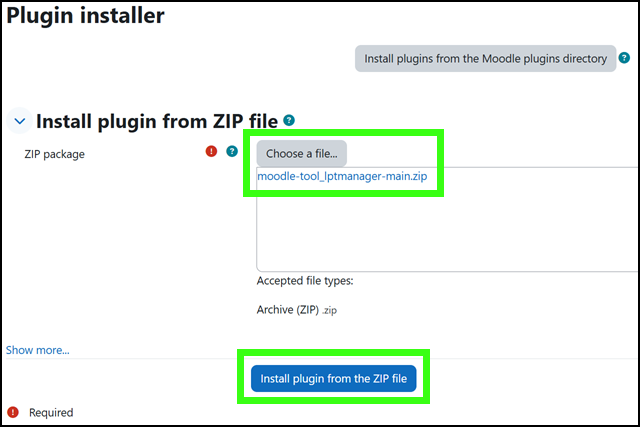
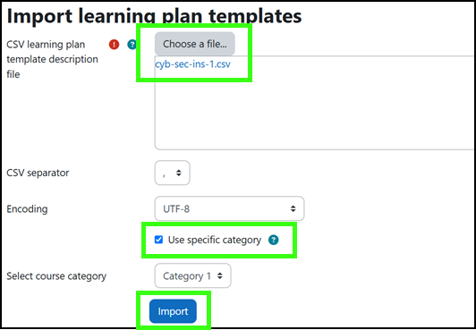
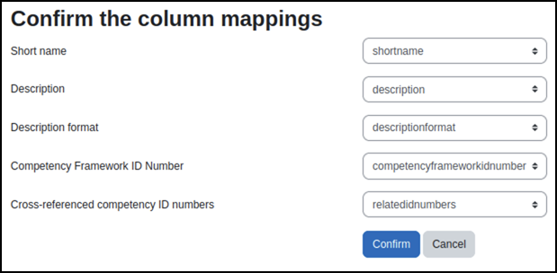

# Learning Plan Template Manager for Moodle 

## Table of Contents

- [Description](#description)
- [Features](#features)
- [Installation](#installation)
- [Usage](#usage)
  - [Importing Learning Plan Templates](#importing-learning-plan-templates)
  - [Exporting Learning Plan Templates](#exporting-learning-plan-templates)
  - [Creating Learning Plan Templates](#creating-learning-plan-templates)
  - [LRS Competency Sync](#lrs-competency-sync)
- [Future Development](#future-development)
- [Contributing](#contributing)
- [License](#license)

## Description

The **Learning Plan Template (LPT) Manager** is a plugin for Moodle that allows for the import, export, and automatic creation of learning plan templates from a competency framework. This plugin was specifically developed for work roles in the NIST NICE Cybersecurity Framework.

Happy Moodling! 🎓

## Features

The **LPT Manager** plugin in Moodle allows users to:

- Import learning plan templates in CSV format. 
- Export existing learning plan templates for external use.
- Match learning plan templates with competency frameworks and automatically create learning plan templates.

## Installation

System admin-type users or users who have the appropriate permissions should follow the procedures below to download and install the LPT Manager plugin.

1. Download the plugin from this repo.
2. Extract the plugin into the following directory in your Moodle installation:

```
admin/tool/lptmanager
```

-or-

1. Click the green **Code** button and select **Download ZIP**.
2. Log into your Moodle as a site administrator or with the appropriate permissions.
3. Click **Site administration**, **Plugins**, **Install Plugins**.
4. Under **Install plugin from ZIP file**, click **Choose a file...**, then **Choose File**, and **Upload this file** (the **moodle-tool_lptmanager-main.zip** file).
5. Click **Install plugin from the ZIP file** and follow the on-screen instructions to complete the installation, including updating the Moodle database.



## Usage

Once the LPT Manager plugin has been installed, Moodle administrators or Moodle users with the appropriate permissions, can use the plugin.

### Importing learning plan templates

1. In Moodle, navigate to **Site administration**, **Competencies**, **Import learning plan templates**.
2. Click **Choose a file...**, then **Choose File** and **Upload this file** to upload the .CSV learning plan template file.

>Choose the option **Use specific category** to import the learning plan template into a specified course category. If none is selected, the default system category is used.

3. Click **Import**.

   

4. **Confirm** the column mappings.

   

5. Upload a properly formatted .CSV file containing learning plan template data. You will receive a success message: *Learning Plan Templates Imported*. 
6. Click **Continue**. 

### Exporting learning plan templates

1. In Moodle, navigate to **Site administration**, **Competencies**, **Export learning plan templates**.
2. Select a learning plan template from the list of learning plans.
3. Click **Export** and export the one file. Select **Export All Learning Plans** to export all of the available templates instead of just the one.

### Creating learning plan templates

1. In Moodle, navigate to **Site administration**, **Competencies**, **Create learning plan templates from competency framework**.
2. Choose a competency framework (e.g., the NICE Workforce Framework) to sync with.
3. For **Competency Name**, enter text that the competency ID numbers contain (e.g., WRL matches DD-WRL-001). The text is matched literally, not as a regular expression.
4. Click **Create**.  Confirm the creation. The plugin will add cross-referenced competencies to the selected learning plan template.

### LRS Competency Sync

The plugin includes a scheduled task that periodically queries an xAPI SQL LRS for TLA MOM competency assertion statements (`asserted` and `validated` verbs) and grades the corresponding competencies in learners' Moodle learning plans.

#### Configuration

1. In Moodle, navigate to **Site administration**, **Plugins**, **Admin tools**, **LRS Competency Sync**.
2. Enable the **Enable LRS sync** checkbox.
3. Configure the **LRS endpoint** (e.g., `http://lrsql:9274/xapi`).
4. Enter the **LRS API key** and **LRS API secret** for Basic authentication.
5. Set the **Competency IRI prefix** to match how competency identifiers appear in xAPI statement object IRIs (e.g., `https://niccs.cisa.gov/workforce-development/nice-framework/ksat/`). The remainder after stripping this prefix is matched against Moodle competency `idnumber` fields.
6. List the **Trusted asserting sources** and **Trusted validating sources**, one per line as `<authority homePage> <authority name> <learner homePage>`: this credential may grade learners identified under this homePage. SQL LRS stamps every statement's `authority` from the credential that wrote it (its name is the credential's id, not the API key), so copy the first two values from a statement the source wrote; the task log prints the authority of every statement it skips. The learner homePage is where the source's learner accounts live, normally the Keycloak realm issuer (`https://keycloak.example.com/realms/crucible`), and never a Moodle site URL. Give each source (Moodle, Blueprint, ...) its own LRS credential, or they cannot be told apart.

Only Agent authorities are accepted; a Group authority (an OIDC client writing for a user) is skipped.

The sync grades nothing until a trusted source is configured. Statements from untrusted sources are skipped, not retried; after adding a source, clear the `lrs_last_sync` config value to re-read the LRS (already-applied statements are not applied twice).

#### How it works

- A scheduled task runs every 15 minutes (configurable in **Site administration > Server > Scheduled tasks**).
- The task fetches xAPI statements with `asserted` or `validated` verbs from the configured LRS, and skips any whose `authority` is not a trusted source for that verb.
- For `asserted` statements, the learner is the actor. For `validated` statements (instructor-rated), the learner is resolved from the TLA `learner` context extension; a validated statement without it is skipped.
- The learner is matched to a Moodle user only when `account.homePage` is the learner homePage configured for the statement's source, by `account.name` matching `user.idnumber` (Keycloak sub). Email (`mbox`) is not used.
- It resolves the xAPI object to a Moodle competency by extracting the competency identifier from the TLA extension or IRI path.
- It settles on one competency framework: the one named in `contextActivities.grouping` (TLA `competency-framework` activity type), which must be installed and in **Allowed competency frameworks**. A statement naming a framework that is missing or not allowed is skipped, never matched by identifier alone, because NICE reuses codes across versions. A statement naming no framework is matched only when exactly one allowed framework has the identifier.
- It finds **all** of the user's learning plans containing that competency and grades it as proficient in each one, unless the learner is already proficient in it. This provides multi-plan propagation — a competency assertion from any trusted source (Moodle, Crucible exercises, external systems) is applied across all of the learner's plans.
- Not regrading a proficient competency is also what stops a loop: each rating fires `competency_user_competency_rated_in_plan`, which logstore_xapi sends back to the LRS as a `validated` statement from Moodle's credential.
- Processed statements are recorded in the `tool_lptmanager_lrs_sync` table to prevent duplicate processing.

### Notes

- **File format**: Ensure .CSV files for import are properly formatted.
- **Existing templates**: If a learning plan template already exists, the system will notify you: `template already exists`.
- **Development status**: Some features (e.g., success confirmation pages) may still be under development.

## Future Development

- A form-based interface to specify regex patterns.
- An approval process to review templates before their creation.
- Reporting features to monitor and manage generated templates.

## Contributing

Contributions are welcome. To report issues, suggest features, or contribute code, please follow the steps below.   

1. Open an issue in the [GitHub Issues](https://github.com/cmu-sei/moodle-tool_lptmanager/issues) section.
2. Create a new branch for your feature or fix.
3. Make your updates.
4. Create and submit your pull request.

## License

Learning Plan Template Manager for Moodle

Copyright 2024 Carnegie Mellon University.

NO WARRANTY. THIS CARNEGIE MELLON UNIVERSITY AND SOFTWARE ENGINEERING INSTITUTE MATERIAL IS FURNISHED ON AN "AS-IS" BASIS. CARNEGIE MELLON UNIVERSITY MAKES NO WARRANTIES OF ANY KIND, EITHER EXPRESSED OR IMPLIED, AS TO ANY MATTER INCLUDING, BUT NOT LIMITED TO, WARRANTY OF FITNESS FOR PURPOSE OR MERCHANTABILITY, EXCLUSIVITY, OR RESULTS OBTAINED FROM USE OF THE MATERIAL. CARNEGIE MELLON UNIVERSITY DOES NOT MAKE ANY WARRANTY OF ANY KIND WITH RESPECT TO FREEDOM FROM PATENT, TRADEMARK, OR COPYRIGHT INFRINGEMENT. Licensed under a GNU GENERAL PUBLIC LICENSE - Version 3, 29 June 2007-style license, please see license.txt or contact permission@sei.cmu.edu for full terms.

[DISTRIBUTION STATEMENT A] This material has been approved for public release and unlimited distribution. Please see Copyright notice for non-US Government use and distribution.

This Software includes and/or makes use of Third-Party Software each subject to its own license.

DM24-1177
